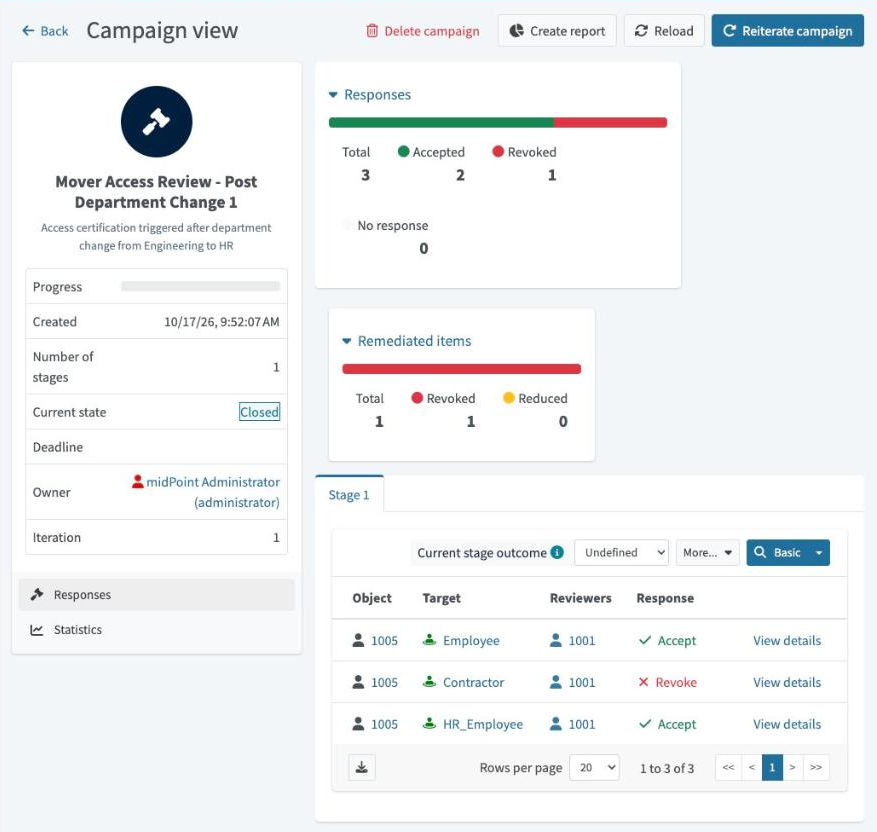
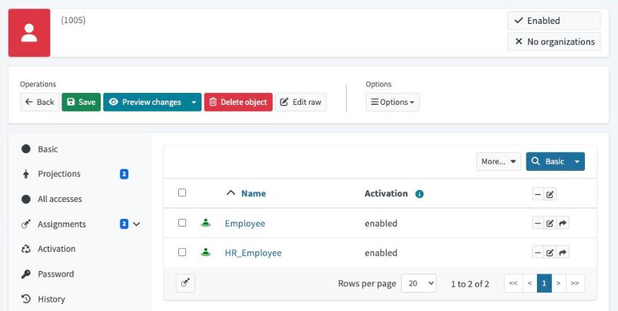
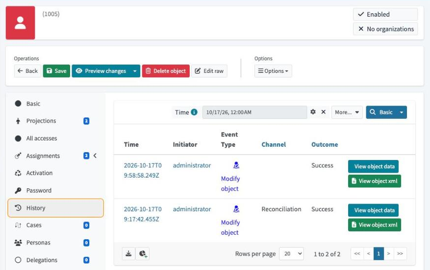

# Access certification: closing the governance loop

After Emma Clarke (`1005`) moved from Engineering to HR, she still held a **Contractor** role she'd requested for her old job. Automation won't remove requested access on a move, by design. So I ran an **access certification campaign**: her manager reviewed each role, revoked Contractor, and midPoint removed it automatically.

**Verified October 17, 2026:** campaign **Closed**, 3 items reviewed (2 accepted, 1 revoked), **1 item remediated**. Emma now holds only Employee and HR_Employee. The removal was made by midPoint's remediation process, not edited by hand. This is a local Docker lab with simulated identities.

> **The governance loop, in one line:** automation handles the predictable changes (the mover swapped her department role), and **people review what automation can't judge** (whether requested access still fits), with the system enforcing their decision.

## Why this matters

Leftover access after a job change is a classic audit finding. A role that was justified in one job quietly carries into the next. Certification answers two things an auditor asks: **"Does anyone still check that access is appropriate?"** and **"When they say no, is it actually removed?"** This lab produces evidence for both.

```text
Requested: Contractor (Oct 9) ──▶ Mover: Engineering → HR (05:17)
                                   Contractor survives the move (by design)
                                          │
                                          ▼
Campaign starts (05:52): 3 items for Emma, reviewer = her manager
Manager decides (05:54): Employee ✔  HR_Employee ✔  Contractor ✘
Stage closed (05:58)  ──▶ automated remediation removes Contractor
```

## What I configured

| Step | What I did | Why |
| --- | --- | --- |
| 0 | Gave Sophie Müller (`1001`) the **End User** and **Reviewer** roles and a login. | The reviewer needs permission to sign in and make decisions. Sophie is Emma's manager in the HR data. |
| 1 | Created the campaign definition *Mover Access Review – Post Department Change*. | One reusable template for this kind of review. |
| 1a | **Scope:** users where `name = "1005"`, role assignments included. | *Whose* access and *which* access. Limited to the mover for this exercise. |
| 1b | **Stage:** one 14-day stage, Sophie set as reviewer. | *Who* decides, and by when. |
| 1c | **Remediation:** automated. | *What happens* to revoked items: removed by the system, not left on a to-do list. |
| 2 | Started the campaign. | midPoint created one review item per role Emma held. |
| 3 | Signed in as Sophie and decided each item. | The business decision is made by the person who knows the job. |
| 4 | Closed the stage as administrator. | Decisions take effect only when the stage closes (see findings). |

## Evidence from my running lab

### 1. The campaign: decisions and remediation



Reviewer **1001** (Sophie) accepted **Employee** and **HR_Employee** and revoked **Contractor**. The campaign is **Closed**, with **1 remediated item**.

### 2. Emma after remediation



Contractor is gone. Compare with [before the review](../rbac-roles/screenshots/mover-emma-after.png) (Contractor, Employee, HR_Employee).

### 3. The audit trail



Two changes to Emma today, both **Success**: the mover (09:17 UTC, Reconciliation) and the removal (09:58 UTC). The history view leaves the channel blank for the second event, but her stored record shows it was made through midPoint's **remediation** channel.

## Configuration

[mover-access-review-definition.xml](artifacts/mover-access-review-definition.xml) is the campaign definition, annotated with the four design questions: scope, items, reviewer, and remediation. Operational metadata is removed. It contains no credentials and is not a complete importable object.

## Findings and limits

- **Decisions don't act until the stage closes.** After Sophie revoked Contractor it was still assigned, because the 14-day stage was open. Closing the stage triggered remediation. Keeping review and enforcement separate means a half-finished review can't remove access. In production, the deadline closes the stage automatically.
- **The reviewer was set by hand.** Sophie was named as the default reviewer. In an enterprise setup, each user's **manager** would be resolved automatically from HR data, so managers review their own reports. That's my next enhancement.
- **Narrow scope on purpose.** One user, three items, to show a targeted mover review. Real programs combine periodic campaigns (everyone, quarterly) with risk-based ones (privileged or requested access) and event-driven ones (recent movers).
- **Directory effect not checked.** Contractor has no inducement, so removing it changes no LDAP account. I didn't inspect the directory in this lab.

**Skills demonstrated:** certification campaign design (scope, items, reviewer, remediation), reviewer enablement, decision workflow, automated remediation, and audit evidence.

**Enterprise equivalent:** certification campaigns in SailPoint IdentityIQ/ISC, access reviews in Microsoft Entra ID Governance, and Saviynt access certification.

**Compliance angle:** periodic access reviews with documented removal are standard evidence for SOC 2 logical-access controls (CC6.2 and CC6.3). This lab produces that evidence trail on a small scale.

**Resume bullet:** Built and ran an access certification campaign in midPoint with the employee's manager as reviewer and automated remediation, revoking stale access left by a department change and producing an auditable review-and-revoke trail.

[Learning source: SimplifyIAM M3 Lesson 4](https://www.skool.com/simplify-iam-6792/classroom/dc510113) · [My Notion lab journal](https://app.notion.com/p/3fc71b972dfd81389dbaeac3737b25a6) · Previous labs: [RBAC and the mover](../rbac-roles/README.md)
