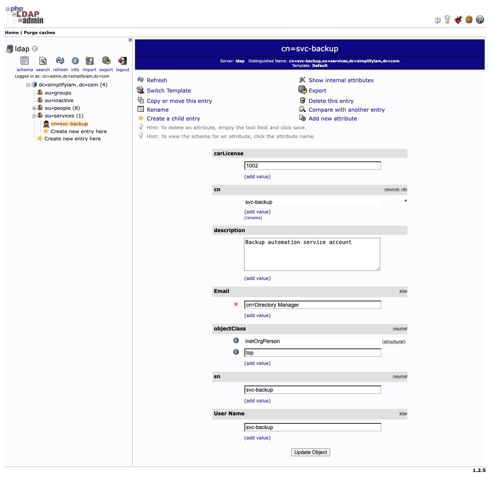
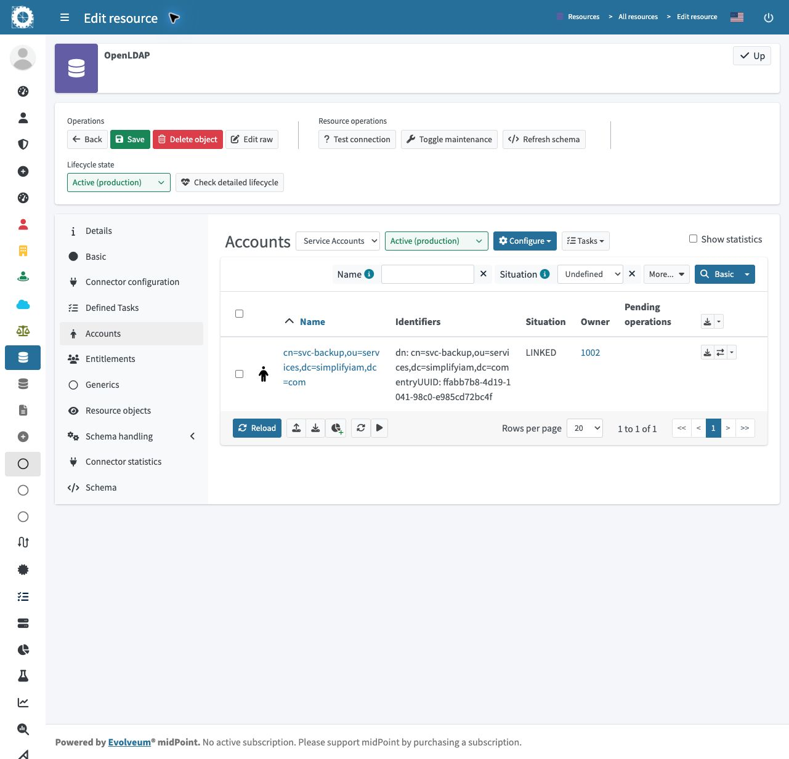
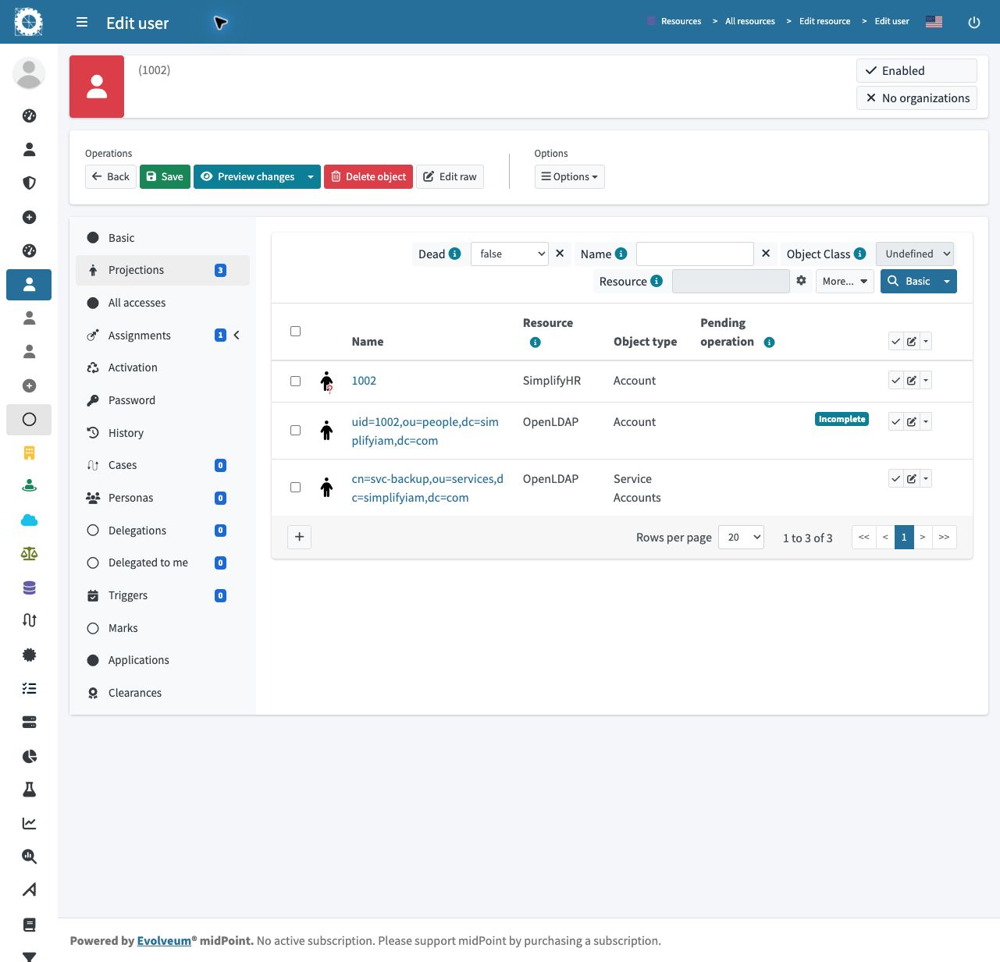

# Service account ownership in midPoint

I linked an existing OpenLDAP service account, **`svc-backup`**, to its responsible human, **James Anderson (`1002`)**, using owner-based correlation in midPoint.

**Verified September 29, 2026:** the service account is **LINKED** to `1002`. James's projections contain his HR record, personal LDAP account, and service account. This is a local Docker lab with simulated identities.

## Why this matters

Applications use service accounts that may never appear in an employee HR feed. Without an owner, nobody is clearly accountable for reviewing their access. This lab makes that responsibility visible in the identity platform.

```text
LDAP: svc-backup → carLicense = 1002
                              │ match owner identifier
midPoint: James → name = 1002 ─┘
          ├── SimplifyHR record
          ├── Personal LDAP account (default intent / ou=people)
          └── Service LDAP account (NHI intent / ou=services)
```

## What I configured

| Steps | What I did | Why |
| --- | --- | --- |
| 1–2 | Created `ou=services` and `svc-backup`; set `carLicense=1002`. | Separate service accounts and record the responsible employee. |
| 3–4 | Used OU-based search scoping; restricted the existing default account type to `ou=people`. | Keep human-account rules from processing service accounts. |
| 5 | Added **Service Accounts**, intent `NHI`, scoped to `ou=services`. | Give this population its own processing rules. |
| 6–7 | Mapped `carLicense → name`, `cn → additionalName`; correlated on `name`. | Match the account's owner number to James's existing identity. |
| 8 | Configured unlinked → link, linked → synchronize, unmatched → no action. | Record valid ownership without creating fake employees for unknown owners. |
| 9 | Configured an NHI reconciliation task and verified the resulting owner link. | Discover and process the service-account population. |

In this lab, `carLicense` is a borrowed owner field and midPoint's `name` holds the employee number. **Correlation finds the person; linking records the relationship.**

## Evidence from my running lab

### 1. The directory account identifies its owner



`svc-backup` exists under `ou=services` and points to employee `1002`.

### 2. midPoint records the ownership link



The Service Accounts filter shows one account, **LINKED**, with owner **1002**.

### 3. One person has both LDAP accounts



There are **three projections, but two LDAP accounts**: SimplifyHR is the third record. The personal LDAP projection carries an **Incomplete** indicator; its cause was not investigated in this documentation pass.

## Configuration and limits

[Saved schema-handling XML](artifacts/schema-handling.xml) contains the verified configuration, with namespace declarations added so the excerpt is readable independently. It excludes connector credentials and is **not a complete importable resource**.

- **Lesson difference:** `cn → additionalName` is strong in my saved configuration; the lesson specifies weak. James's additionalName currently contains `svc-backup`. This affects the human identity and needs review before extending the design.
- The NHI task is CLOSED; that status alone is not proof of an error-free run. The account and owner views independently confirm the link.
- The unmatched reaction has no action, but the optional `svc-orphan` test was not verified. Ownership linking does not demonstrate password management, authentication, certification, or owner-departure handling.

**Skills demonstrated:** LDAP organization, account-type scoping, inbound mappings, owner correlation, synchronization rules, and evidence-based validation.

**Resume bullet:** Linked an LDAP service account to its human owner in a local midPoint lab using separate account intents, inbound owner mapping, and correlation; verified ownership through resource and user projection views.

[Learning source: SimplifyIAM Lesson 7](https://www.skool.com/simplify-iam-6792/classroom/dc510113?md=ee6871d7da854dcc8721432781e4cbef) · [My step-by-step Notion note](https://app.notion.com/p/3ea71b972dfd816b94edfa5def0aff47)
