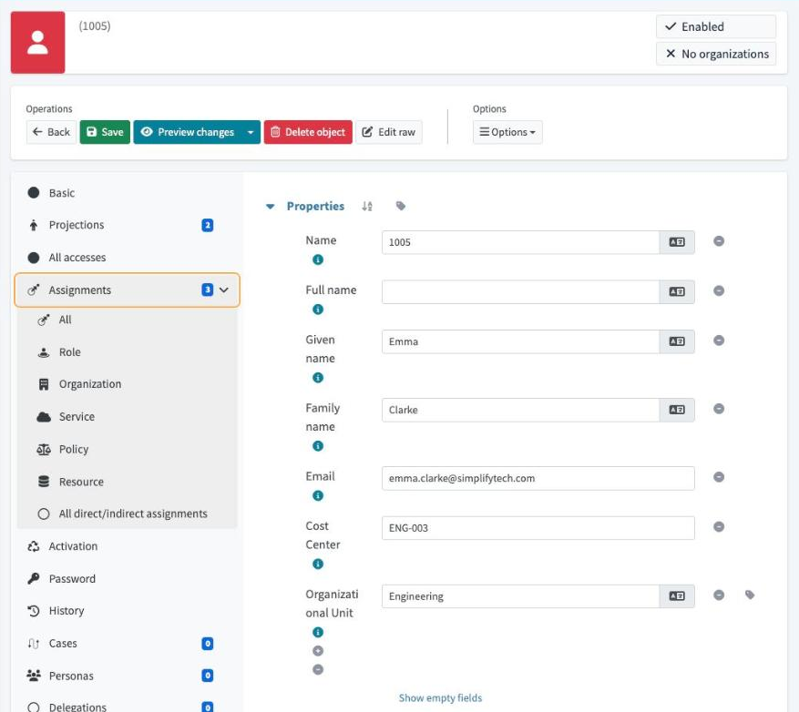
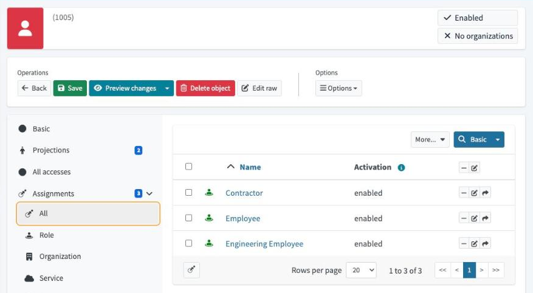
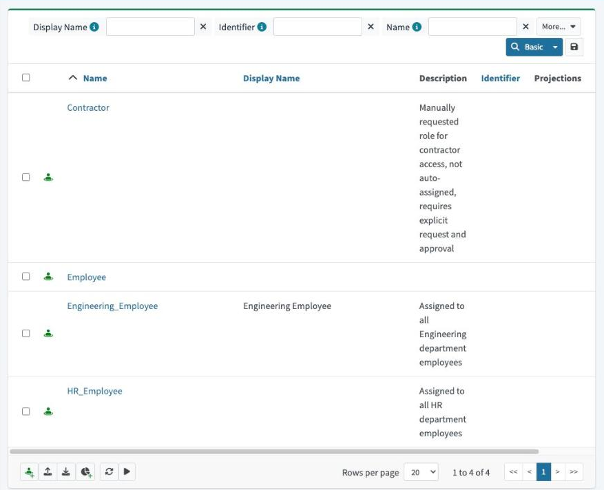
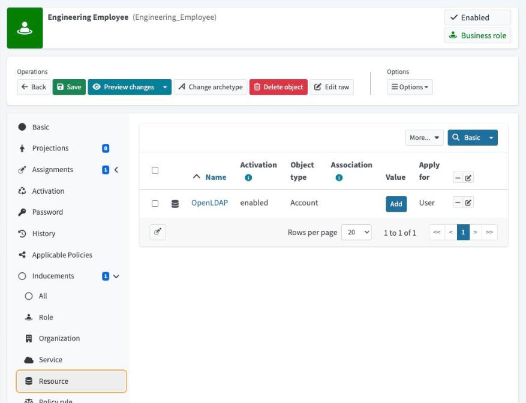

# Role-based access control (RBAC) in midPoint

I built three business roles that decide access from HR data. Two of them assign themselves from the employee's department, and one has to be requested. An Engineering employee now gets the role, and the directory account that comes with it, without anyone assigning it by hand.

**Verified October 17, 2026:** Emma Clarke (`1005`, Engineering) holds **Employee**, **Engineering_Employee** and **Contractor**. Across all eight lab users, every department-role holder matches the department in the HR source. This is a local Docker lab with simulated identities.

> **Auto-assigned vs requested, in two lines**
> **Auto-assigned** roles follow an HR attribute. Engineering_Employee is granted when department = Engineering and removed when it changes, with no ticket and no approval.
> **Requested** roles follow a human decision. Contractor is only granted through a self-service request, so there is a record of who asked and for whom.

## Why this matters

Granting access person by person, system by system, leads to **access creep**: people keep old permissions after they change jobs, and nobody can explain why someone has what they have. RBAC ties access to a **role**, so it's consistent (same job, same access), automated, and auditable ("Emma has LDAP access because she holds Engineering_Employee, which she holds because HR lists her in Engineering").

```text
SimplifyHR: Emma, department = Engineering
        │  reconciliation (M2) → midPoint organizationalUnit = Engineering
        ▼
Auto-assign rule on Engineering_Employee: organizationalUnit == 'Engineering'  (strong)
        │  recompute
        ▼
Emma holds Engineering_Employee ──inducement──▶ OpenLDAP account (account / default)

Self-service request ─────────────────────────▶ Emma holds Contractor (no auto-assign)
```

## What I configured

| Step | What I did | Why |
| --- | --- | --- |
| 1 | Created **Engineering_Employee** (business role) with an inducement for an OpenLDAP account (kind `account`, intent `default`). | Holding the role grants the directory account. |
| 2 | Created **HR_Employee** with **no inducement**. | A role can record a business fact without granting a system entitlement. |
| 3 | Created **Contractor** with no inducement and no auto-assign rule. | Elevated access should need a deliberate request, not an attribute match. |
| 4 | Added an `autoassign` rule to each department role: `organizationalUnit == 'Engineering'` / `'HR'`, strength **strong**. | Each role owns its eligibility rule. *Strong* means the rule is rechecked on every recompute, so the role also comes **off** when the department changes. |
| 5 | Ran **Recompute All users**. | Departments were already in midPoint, so re-running the rules was enough. No HR re-read was needed. |
| 6 | Requested **Contractor** for Emma through **Request access** (self-service). | Exercises the request path instead of an admin editing the user directly. |

**Key terms:** an *assignment* gives a role to a person. An *inducement* is what the role passes on to whoever holds it (here, the LDAP account).

## Evidence from my running lab

### 1. The HR department reaches midPoint



Emma's `organizationalUnit` is **Engineering**, mapped from SimplifyHR in Module 2. This is the attribute the auto-assign rule reads.

### 2. Emma has both role patterns



Three assignments. Her raw record shows how each one arrived:

| Role | How it was assigned | midPoint channel | Date |
| --- | --- | --- | --- |
| Employee | HR onboarding (Module 2) | reconciliation | Sep 19, 2026 |
| Engineering_Employee | **Auto-assign rule** | recompute | Oct 9, 2026 |
| Contractor | **Self-service request** | user | Oct 9, 2026 |

### 3. The three business roles



### 4. The Engineering role grants an OpenLDAP account



One inducement: an **OpenLDAP account** that applies to users.

### 5. The rules assigned the right people

| User | HR department (cost centre) | Department role held |
| --- | --- | --- |
| 1001, 1003, 1005 | Engineering (ENG) | Engineering_Employee |
| 1006 | Engineering (ENG), **terminated** | Engineering_Employee *(see findings)* |
| 1004 | HR (HR) | HR_Employee |
| 1002, 1007, 1008 | Finance, IT, Operations | none, as expected |

## Configuration

- [engineering-employee-role.xml](artifacts/engineering-employee-role.xml): business role, OpenLDAP inducement, strong auto-assign rule
- [hr-employee-role.xml](artifacts/hr-employee-role.xml): business role, auto-assign rule, no inducement
- [contractor-role.xml](artifacts/contractor-role.xml): requestable business role, no auto-assign

These are annotated excerpts with operational metadata removed. They contain no credentials and are **not complete importable objects**.

## Findings and limits

- **No approval step yet.** The Contractor request was submitted through self-service, but midPoint created **no approval case**, because no approval policy is configured on the role, so the request was granted directly. The request path is shown; an approval workflow is not. That comes later in the course.
- **Terminated user still holds a department role.** Oliver Bennett (`1006`) is terminated in HR but still matches `organizationalUnit == 'Engineering'`. The rule checks department only, not status. His directory removal is handled by the leaver process ([see joiner/leaver lab](../joiner-leaver/README.md)), but a production rule should also require an active status.
- **Setup leftover.** Each role object carries an `Employee` assignment on itself, added during creation. It doesn't flow to members, but it should be cleaned up.
- **The mover isn't tested here.** Strength *strong* is what should make the role swap when a department changes. I'll verify it in the next lab (Emma moves Engineering → HR).
- **Design simplification.** In a full enterprise model, business roles would include *application roles* that hold the entitlements. Here, a business role points straight at the LDAP account to keep the lab small.

**Skills demonstrated:** RBAC design (birthright vs requestable roles), attribute-based auto-assignment, resource inducements, recompute vs reconciliation, self-service access requests, and checking results against the source of truth.

**Enterprise equivalent:** birthright roles and role-assignment rules in SailPoint, role assignment policies in Saviynt, and dynamic groups with lifecycle workflows in Entra ID Governance.

**Resume bullet:** Designed and implemented an RBAC model in midPoint with attribute-based automatic role assignment using role-level auto-assign rules and a self-service access request flow; verified role membership for all users against the HR source.

[Learning source: SimplifyIAM M3 Lesson 2](https://www.skool.com/simplify-iam-6792/classroom/dc510113) · [My step-by-step Notion note](https://app.notion.com/p/3f371b972dfd816bad92f2a2a6affcad)
